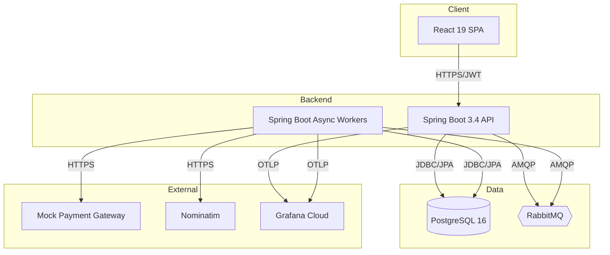

<div align="center">
  
  <p>
    Vantage — A production‑grade, multi‑tenant SaaS platform for independent merchants – with distributed order orchestration, optimistic concurrency control, and statistical demand forecasting.
  </p>
  <p>
    <a href="https://adoptium.net/"></a>
    <a href="https://spring.io/projects/spring-boot"></a>
    <a href="https://react.dev/"></a>
    <a href="https://www.postgresql.org/"></a>
    <a href="https://www.rabbitmq.com/"></a>
    <a href="https://github.com/elcoosp/vantage/actions"></a>
    <a href="LICENSE"></a>
  </p>
</div>

---

## Demo

https://github.com/user-attachments/assets/a94a091a-66a5-4997-b160-e6adbaa47d9d

<div align="center">
<p><em>Full walkthrough: login → dashboard → order search → low-stock fix → new product → AI demand forecast → developer portal.</em></p>
</div>

---

## Why Vantage?

Vantage is a full‑stack demonstration of senior‑level engineering, designed to solve real‑world distributed systems problems:

- Multi‑tenant isolation – Hibernate `@Filter` guarantees zero data leakage between vendors.
- Flash‑sale concurrency – JPA `@Version` optimistic locking prevents overselling without database locks.
- Distributed Saga + Outbox – At‑least‑once delivery with compensating transactions (Chaos Monkey).
- Resilience4j – Circuit breakers, retries, bulkheads, and rate limiters for graceful degradation.
- End‑to‑end tracing – OpenTelemetry and Grafana Tempo stitch together every request and event.
- Statistical demand forecasting – Holt-Winters exponential smoothing with confidence intervals.

---

## Architecture Overview



---

## Technology Stack

| Layer          | Technologies                                                                 |
|----------------|------------------------------------------------------------------------------|
| Backend        | Java 21, Spring Boot 3.4, Spring Modulith, Hibernate, Flyway, JWT, Resilience4j |
| Frontend       | React 19, TypeScript, Vite, TanStack Query, Tailwind CSS, Recharts, Leaflet   |
| Infrastructure | PostgreSQL 16, RabbitMQ, Testcontainers, Docker Compose                  |
| Observability  | Micrometer, OpenTelemetry, Grafana Tempo, Loki, Prometheus               |

---

## Quickstart (Local Development)

```bash
git clone https://github.com/elcoosp/vantage.git
cd vantage

# Start PostgreSQL and RabbitMQ
docker-compose up -d

# Run the backend
cd backend
./gradlew bootRun

# Run the frontend (in another terminal)
cd frontend
npm install
npm run dev
```

Open [http://localhost:5173](http://localhost:5173) and start exploring.

**Demo tenant** (seeded by Flyway): `admin@vantage.com` / `password123` — with 3 products, live inventory, and ~34 historical orders.

## What actually runs (verified end to end)

Everything below is implemented and covered by automated tests — this is the
checklist of things that used to be *advertised* but not *wired*:

- **Checkout saga, ON by default** — `POST /api/v1/orders` publishes through
  the transactional outbox → RabbitMQ (`vantage.events`), inventory reserves
  stock, the mock payment gateway captures, and the order lands in `PAID`
  within seconds. Failure injection (Chaos Monkey, `POST
  /api/v1/admin/chaos-monkey/payment-failure`) drives the compensating path:
  the order becomes `CANCELLED` and reserved stock is released.
- **Order fulfillment lifecycle** — `PATCH /api/v1/orders/{id}/ship` and
  `PATCH /api/v1/orders/{id}/deliver` advance `PAID → SHIPPED → DELIVERED`,
  update the CQRS search projection, and emit lifecycle events. The
  `OrderStatus` enum now matches the seeded data (previously `SHIPPED` /
  `DELIVERED` rows could not even be loaded by JPA).
- **Live Ops Map (STOMP/WebSocket)** — real `spring-boot-starter-websocket`
  backend at `/ws`, per-tenant broadcast on `/topic/ops-map.<tenantId>`,
  JWT validated per STOMP CONNECT frame and subscriptions constrained to the
  caller's tenant. Every order lifecycle event becomes a pin on the map.
- **Developer portal, real data** — API keys (`vnt_live_…`, bcrypt-hashed),
  webhook config with a proper `GET /api/v1/webhooks` (URL + masked secret),
  and a **live API request log** streamed over Server-Sent Events from
  `GET /api/v1/developer/logs/stream` (replaces the previous `Math.random()`
  mock).
- **AI support chat** — the widget now authenticates with the same JWT as the
  rest of the app (it previously read a localStorage key that was never
  written, so every message 401'd).
- **E2E suite** — `frontend/e2e/app-journey.spec.ts` drives the real UI:
  register/login → product create → inventory edit → order saga → fulfillment
  → audit timeline → api keys → webhook round-trip → chat → ops map.
  `e2e-smoke-test.sh` scripts the same journey against the API.

## Running tests

```bash
# Backend unit tests + coverage (qualityGate = test + jacocoTestReport)
cd backend && ./gradlew qualityGate

# Frontend build
cd frontend && npm run build

# E2E (needs Postgres + RabbitMQ + backend on :8080; vite starts itself)
cd frontend && npx playwright install --with-deps && npm run e2e

# Full API smoke journey (docker-compose based)
./e2e-smoke-test.sh
```

---

## Contributing

Please read our [Contribution Guidelines](CONTRIBUTING.md) and [Code of Conduct](CODE_OF_CONDUCT.md) before submitting pull requests.

---

## License

Proprietary – see [LICENSE](LICENSE) for details.
EOF
